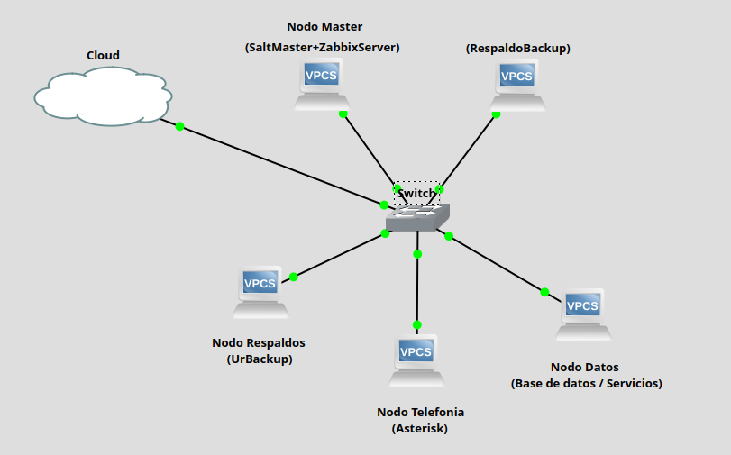

### Topología en Estrella ⭐

Nuestra arquitectura utiliza una **topología en estrella**, donde un nodo central o switch virtual conecta y distribuye el tráfico entre los nodos Master, Backup, Datos, Telefonía y Respaldos. 🌐

**¿Por qué elegimos esta topología?** Porque facilita la administración de la red, permite controlar el tráfico desde un punto central y ayuda a aislar fallos. Además, se adapta fácilmente a nuestro entorno virtualizado, mejorando la organización y la comunicación entre los servidores. 💻🔗

